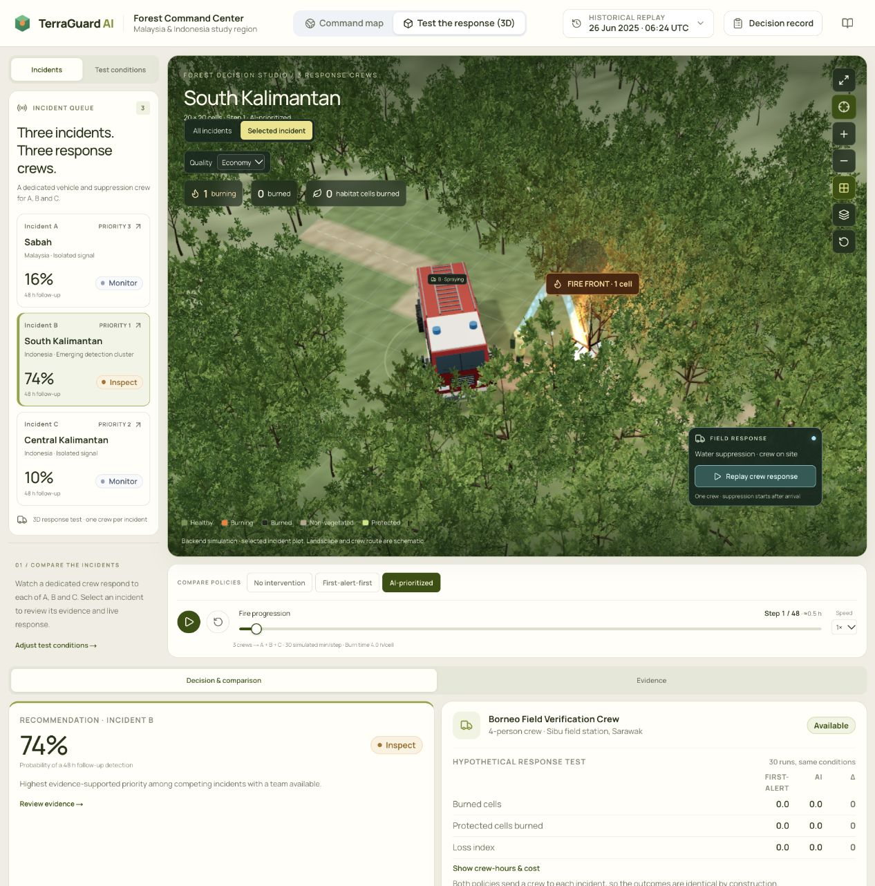

# نتيجة المرحلة الأولى: تخفيف محاكي الغابة

التاريخ: 11 أكتوبر 2026. الفرع: `codex/frontend-studio`. نفذت التعديلات والمراجعة مباشرة؛ توقف استخدام الوكلاء الفرعيين بناءً على طلب المستخدم.

## ما تغير

- اختيار جودة Auto / Economy / Balanced / High، مشترك بين عرض المناطق الثلاث والمنطقة المفردة. تبدأ الجودة التلقائية متوسطة، وتنخفض بعد بطء مستمر وتتعافى تدريجيًا. لا تستخدم فترات الإيقاف أو إخفاء الصفحة كعينات أداء.
- أشجار خلفية أقل تعقيدًا، وأشجار الحوادث الكاملة في الجودة المتوسطة والعالية؛ موارد مشتركة حسب النوع والتفاصيل، مع تحريرها بعد انتهاء آخر مستخدم.
- تجميع أجزاء السيارة الثابتة حسب الخامة، وتجميع كل عجلة مستقلة مع الحفاظ على دورانها؛ تبقى خامة الإشارة المتحركة مستقلة.
- تقليل مثلثات الأرض المشتركة من 75,900 إلى 19,090، وتجميع الشبكة وحدود المناطق المحمية وطبقات الخلايا والتوهج.
- إعادة استخدام حسابات المسارات والكائنات المؤقتة للمؤثرات، وتقليل جسيمات النار والدخان والماء حسب الجودة. تبقى شعلة واحدة على الأقل لكل خلية مشتعلة في الجودة المنخفضة.

تظل شبكات الحوادث 20×20 وأحداث الوصول ونتائج السياسات من الخلفية كما كانت. لم يتغير backend أو مخزن إعدادات المحاكاة أو ملفات الحزم والقفل. أصلح فحص الإنتاج أيضًا تعريفين غير متوافقين لقيمة tooltip في `MethodologyDrawer`.

## القياس المحلي

نسختا إنتاج على الجهاز نفسه داخل متصفح Codex، على `http://localhost:3001/simulation`. السيناريو `SCN-20250626`، سياسة AI-prioritized، المناطق A/B/C معًا، سرعة 1×، تأخير الاستجابة 1 وخطوة الاحتراق 8 وأفق 48. لم يتغير حجم التبويب بين القياسين؛ حجم العرض المسجل في التحقق النهائي 1266×1282، ومساحة Canvas نحو 1011×724 CSS pixels.

استُخدم Chrome tracing بفئتي `devtools.timeline` و`disabled-by-default-devtools.timeline.frame`. في كل تسجيل، أخذت نافذة ثماني ثوان تبدأ بعد ثانية من أول `FireAnimationFrame`، وحسبت أحداث `DrawFrame` الفريدة وفواصلها. النسخة الجديدة تعمل في Auto، لذا تشمل المقارنة أثر تخفيف التفاصيل ودقة العرض التلقائية ضمن تجربة الاستخدام.

| المقياس | قبل التعديل | بعد التعديل |
|---|---:|---:|
| إطارات DrawFrame خلال 8 ثوان | 55 | 308 |
| معدل الإطارات المرصود | 6.9/ث | 38.5/ث |
| المئين 95 لفاصل الإطار | 436.0 ms | 73.5 ms |
| المئين 95 لمدة callback الحركة | 427.9 ms | 5.1 ms |

هذا تحسن بنحو 5.6 أضعاف في معدل الإطارات المرصود في هذه العينة. في قراءة لاحقة عند الخطوة 10 سجل عداد Canvas نحو 48.6 إطارًا/ث، و178 عملية رسم، و3,074,394 مثلثًا؛ هذه قراءة منفصلة وليست متوسط نافذة المقارنة.

**حدود الدليل:** تسجيل واحد قبل وآخر بعد على الجهاز المحلي، وليس مجموعة أجهزة أو متوسط تكرارات. `DrawFrame` مؤشر لعرض المتصفح، ويتأثر بالتسجيل نفسه وحمل الجهاز؛ لا يثبت أداء 60 إطارًا/ث على كل الأجهزة. لم تُقَس ذاكرة GPU أو حالات فقد WebGL أو الهاتف أو تقليل الحركة في هذه المرحلة. الانخفاض إلى تفاصيل أخف جزء مقصود من الجودة التلقائية؛ انتقالات LOD المكانية السلسة لاحقة.

## التحقق

- نجحت 21 حالة اختبار: حالات الخلايا، أحداث الوصول، الماء، استمرار الحركة، ذاكرة المسار، حدود الجودة والتعافي، ملكية الموارد ومشاركة StrictMode، وتحويلات تجميع السيارة واستثناء الإشارة المتحركة.
- نجح `npx tsc --noEmit --incremental false` وESLint للملفات المعدلة و`git diff --check`.
- نجح بناء إنتاج Next.js 15.5.27؛ صفحة `/simulation` بحجم 147 kB وFirst Load JS نحو 254 kB. يبقى تحذير جذر workspace بسبب تعدد ملفات القفل السابق لهذه المرحلة.
- فحص المتصفح: مستويات الجودة الأربعة، بقاء الخطوة 10 عند تغيير الجودة، العرض المفرد والعام، الشبكة والمناطق المحمية، إعادة الكاميرا والتركيز، إعادة حركة الفريق، وتبديل السياسة. لا تدخل عند الخطوة 12: A=25/B=18/C=14 خلية مشتعلة.
- فحص تأخير الوصول: عند تأخير 4 خطوات، كانت B في الطريق دون ماء بالخطوة 3؛ ظهرت حالة Spraying بالخطوة 4. أُعيد التأخير إلى 1 بعد الاختبار.
- لم تظهر أخطاء console في فحص النسخة الجديدة. لم تُرسل قرارات أو أوامر Send crew المسجلة.

## ما يلي

تحديث لاحق بطلب المستخدم: كُبّرت سحب الدخان وارتفاعها فوق الأشجار، ثم استبدلت الكرات بسحب تواجه الكاميرا وخامة محلية إجرائية 128×128 بحواف متعرجة وناعمة وتفاوت في الكثافة. تتمدد السحابة أثناء الارتفاع وتتلاشى قبل إعادة دورة الجسيم، مع تتابع يضمن وضوح المعاينة المتوقفة أيضًا. ميزانية الجسيمات نفسها؛ كل سحابة تستخدم مستطيلًا من مثلثين، والخامة تتولد مرة واحدة عند تحميل المؤثر. أضيف اختباران لتمدد السحابة وتلاشيها وحدودها وإعادة استخدام كائن الحساب، ليصبح الإجمالي 23 اختبارًا. قياس الأداء أعلاه سبق تعديل الدخان؛ لم يُعَد benchmark كامل له.

نجحت الاختبارات الـ23 وبناء الإنتاج وESLint بعد تحديث الدخان، وفُحصت السحب في المتصفح على Auto وEconomy وHigh دون أخطاء console. [معاينة السحب الجديدة](verification/forest-realistic-smoke.jpg).

تحديث الإطفاء التدريجي: أصبح للمؤثرات سجل عمر مستقل مستمد من إطارات سياسة المحاكاة. يبدأ تراجع حرارة الخلايا المخمدة بعد وصول الفريق في آخر خطوة اشتعال، ثم ينكمش اللهب ويخف سطوعه وتوهجه خلال 2.4 ثانية من وقت العرض بعد انتقال الخلفية. السحب الموجودة تواصل ارتفاعها وتوسعها وتلاشيها، وتتوقف إعادة توليد الجسيم بعد انتهاء المصدر؛ أقصى عمر متبقٍ يقارب 13.3 ثانية عرض. تتوقف هذه الحركة مع الإيقاف، وتُعاد حالتها من الخط الزمني عند السحب أو إعادة التشغيل أو تبديل المنطقة والسياسة. لا تتغير نتائج الخلفية أو أعداد الخلايا بسبب الحرارة البصرية المتبقية.

نجحت 28 حالة اختبار وفحص الأنواع وESLint وبناء الإنتاج لهذا التحديث. التحقق المرئي في B: رش الماء في الخطوة 1، حالة تبريد مع لهب متراجع في الخطوة 2، ثم غياب اللهب وبقاء الدخان في الخطوة 4، واختفاء المؤثرات في نهاية الإعادة. فُحصت الإعادة والعرض العام دون أخطاء console. [مرحلة التبريد](verification/fire-cooling-transition.jpg)، [الدخان بعد انطفاء اللهب](verification/smoke-after-extinction.jpg). الأداء لم يُقَس مجددًا كـbenchmark شامل بعد هذه الإضافة.

توزيع A/B/C المتباعد والمحطة والطرق، ثم تطوير الأرض والعشب والرياح والأصول المختارة. التصميم الكامل ما زال مرحلة تالية. عند انتهاء فحص تحسينات المحاكاة أعلاه، لم يُدفع الفرع أو يُدمج في main وكانت التغييرات متاحة للمراجعة محليًا.

## تحديث الفرع من main — 11 أكتوبر 2026

دُمج `origin/main` عند `e222155` في `codex/frontend-studio` بالدمج `83d9af7`، ثم أضيف إصلاح التوافق `cc65f33`. حُفظ العمل المحلي في stash ومرجع مستقل `refs/codex-backups/main-sync-20261011`، مع فرع سابق للدمج `codex/frontend-studio-before-main-20261011`؛ أعيدت الملفات المحلية بعد الدمج ولم تُحذف النسخة الاحتياطية. إعداد include المحلي أصبح ضمن إعداد main نفسه.

عولجت تعارضات CommandCenter وTimeline وstore وpackage-lock مع الاحتفاظ بالمحاكاة الحالية وإضافة تقارير main. مقارنة A/B/C تستخدم ثلاثة فرق، ومعاينة تبعات القرار تستخدم فريقًا واحدًا؛ إخفاق طلب المعاينة لا يستأنف محاكاة قديمة. أعيد توفير retry عند فشل بلاطات صورة متاحة، وحدّثت اختبارات Earth View لمطابقة إزالة NDVI والمقارنة من واجهة main. حُفظ ترتيب الخريطة ولوحة القرار على الشاشات الضيقة. أعيد توليد القفل وفق الحزم المدمجة ونجح npm ci.

التحقق بعد إعادة العمل المحلي: 76 اختبار واجهة، 155 اختبار باكند، ESLint، وبناء الإنتاج مع فحص TypeScript على Next.js 16.4.0. فُحصت تقارير التوقع والتوصية ومعاينة تبعات القرار، الرجوع إلى مقارنة بثلاثة فرق، وخريطة العرض الضيق، ثم B في الخطوة 4: صفر اشتعال مع ماء التبريد ودخان متبقٍ. لا أخطاء console في الفحص النهائي ولا قرارات تشغيلية مسجلة. لم يُعَد benchmark الأداء.

عند انتهاء فحص تحديث الفرع من main، كان الدمج محليًا ولم يُدفع إلى GitHub أو يُدمج الفرع في main. كانت تحسينات المحاكاة السابقة حينها تغييرات غير ملتزمة؛ هذه الفقرة تسجل حالة ذلك الفحص قبل طلب دمج الفرع.
